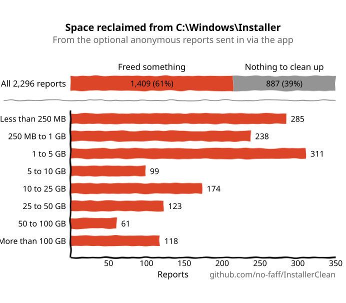

# InstallerClean privacy policy

Last updated 24 October 2026.

InstallerClean never collects anything that could identify you, your PC or your files. No ads, no tracking. It can send me one anonymous report of how its first run on your PC went, which you can stop by unticking a box, or by answering no in the command-line tool, and it checks GitHub for updates, which you can turn off. That's all it sends.

## The anonymous report

When InstallerClean's first run on a PC finishes, its result screen has a box, "Send anonymous report", which starts ticked. If it's ticked, the report goes when you close that screen. If you untick it, nothing is sent, then or ever. If InstallerClean crashes or is ended from outside, in Task Manager for example, before you close it, nothing is sent. The small "i" beside the box shows what the report holds.

There is never more than one report per PC, and it is from the first run. No later run writes or sends another, from any Windows account. If the report can't be sent, because there's no network for example, InstallerClean keeps it and tries again each time you open it until it goes.

**What it holds.** Numbers and fixed labels only:

- InstallerClean's version, the language it was showing, how it was got (setup, portable, slim, Scoop, the command-line tool on its own, built from source, or not known), whether the report was sent from InstallerClean or the command-line tool, and the version of the report's format.
- Windows 10 or 11, whether it's x64, Arm or 32-bit Windows, and the language and Country or region Windows is set to.
- Whether the run was a scan, a Move or a Delete, whether it finished, how long the scan and the Move or Delete took, how many files it moved or deleted, how many it couldn't, and how much space it freed. For a Move, whether the files went to the same drive, another drive, a removable drive or a network share.
- How many installer files Windows has a record of, how many are missing, how many were no longer needed, and how much space they take.
- How many files InstallerClean left alone, and why.
- How many programs and patches Windows has a record of, and how each of InstallerClean's checks of those records and of the installer files came out, including any it couldn't read.
- How often it had to wait for a slow drive or network share, and how many it gave up on.
- Whether Windows still makes old-style short file names, and how many file names are too long to be one.
- Counts of anything that went wrong, by kind.

Nothing in it names you, your PC, a file, a folder, a drive or a program.

**Where it goes.** To nofaff.netlify.app, a site of mine hosted by Netlify. Netlify receives your IP address with the report, as any web host does with any request. My code that receives the report never reads your IP address or stores it, so I never see it. What my code keeps is the report, the time it arrived and the version of InstallerClean that sent it. The reports are what this chart is built from:

  <picture>
    <source media="(prefers-color-scheme: dark)" srcset="docs/reports-en-dark.svg" />
    <source media="(prefers-color-scheme: light)" srcset="docs/reports-en-light.svg" />
    
  </picture>

**On your PC.** The report is saved as `last-run.json` in `%LOCALAPPDATA%\InstallerClean` when that result screen appears, or when the command-line tool asks, whether or not you leave the box ticked or answer yes, and that file is exactly what's sent. The "See exactly what's sent" link in the panel the small "i" opens shows it to you.

## Update check

When you open InstallerClean, it asks GitHub whether there's a newer version. That's one request to github.com. If there is one, InstallerClean says so, and also reads update.json, a small file in that version's release on GitHub that says what each download needs, to tell whether this copy can install it. A copy installed by Scoop doesn't read update.json, because Scoop does its updating. With each request, GitHub sees your IP address, as any website does, and a line naming InstallerClean and its version. Nothing else is downloaded unless you click Update now, which downloads the newer version from its release on GitHub and installs it. Check for updates makes the same check, only when you click it.

The command-line tool makes the same check before a scan, Move or Delete. Where someone is at the console to answer, it asks before it updates. Where nobody is, such as a scheduled task or a script, it downloads the newer version from GitHub, installs it without asking and runs the command with it.

You can turn the check off in the About screen, which turns it off for InstallerClean and the command-line tool, for the Windows account that runs them. Adding `/noupdate` to a command skips it for that run.

## The first-run record

To know a PC has had its first run, InstallerClean sets a value named `FirstRunRecorded` in the registry at `HKEY_LOCAL_MACHINE\SOFTWARE\NoFaff\InstallerClean`. It covers every Windows account on the PC, and it stays there if you uninstall InstallerClean. To tell whether the PC was cleaned before that value existed, InstallerClean also looks, on your PC, for an earlier report from your account and for the command-line tool's entries in the Windows event log.

## The command-line tool

Where someone is at the console, it asks whether to send the same anonymous report as InstallerClean, once, after the PC's first finished run, and sends it only if the answer is yes. The question names the file the report is saved in, and typing `?` shows what the report holds and the report itself. If the report can't be sent, it is kept, and the next run at a console sends it without asking again. Where nobody is, such as a scheduled task or a script, it sends no report, and checks for updates as set out above. It writes one summary line per run to the Windows Application event log, with further lines for conditions it found on the PC and for each update it makes or can't make. After a Move or Delete that moves or deletes files, or ends where how far it got isn't known, or when it asks to send the report, it sets the `FirstRunRecorded` value described above. The summary lines, the notices and the value stay on your PC.

## Everything else stays on your PC

In `%LOCALAPPDATA%\InstallerClean`, for your Windows account:

- `settings.json`: the folder you chose for Move, the language you picked, whether the update check is on, and whether your report has been sent or is waiting to be.
- `crash.log`: details of any error, with the one before kept as `crash.log.old`.

On a PC where an earlier version kept these files in `%LOCALAPPDATA%\NoFaff\InstallerClean`, InstallerClean moves them here the first time it starts.

None of them ever leaves your PC. The buttons for the documentation, the project page and the donate page open your browser, and only when you click them.

The source is public at [github.com/no-faff/InstallerClean](https://github.com/no-faff/InstallerClean), so you can check every word of this for yourself.
